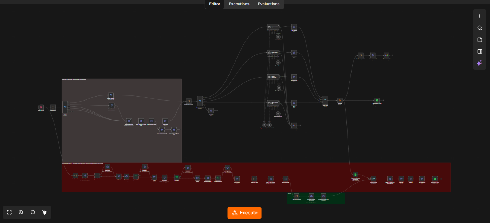

# Automatización de documentos de comercio exterior

Workflow de n8n que recibe documentos de una operación de importación
(factura, anexo, packing list, BL), extrae los datos con IA, los cruza
entre sí y avisa si hay diferencias.

## Problema que resuelve
Revisar a mano que factura, packing list y BL coincidan es lento y
propenso a errores. Este flujo lo hace en minutos.

## Cómo funciona
1. Un portal envía los archivos por webhook.
2. Cada documento se lee (PDF, Excel, CSV, Word) y se manda al agente de IA que le corresponde.
3. Se arma un cuadro comparativo que marca coincidencias y diferencias.
4. Los archivos se guardan en Drive, ordenados por cliente, año, mes y operación.
5. Los resultados se guardan en Supabase y llega un mail con el resumen.

## Stack
n8n · OpenAI · Supabase · Google Drive / Sheets · Gmail

## Cómo importarlo
1. En n8n: menú → Import from file → `workflow-sanitizado.json`.
2. Reemplazá los `YOUR_...` por tus propias credenciales e IDs.

## Resultado

